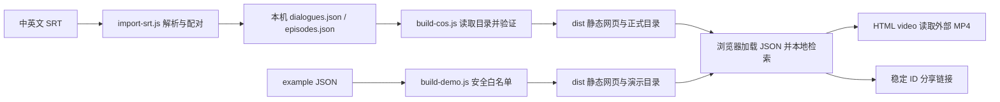

# 本项目的 SDD：先约定，再实现，再验证

## SDD 是什么

SDD（Spec-Driven Development，规范/规格驱动开发）是把自然语言想法整理成可讨论、可验证的需求，再按设计和任务逐步实现的开发方式。AI 负责协助分析、拆解、编码和验证；产品边界与是否验收，仍由项目负责人判断。

它解决的不是“让 AI 多写一份文档”，而是让每次改动都有可追溯的依据：**需求说明系统应该表现什么，设计说明用什么结构实现，任务说明按什么顺序完成，测试和人工验收说明证据是什么。** 发现偏差时，先修正需求或设计，再同步代码、测试和进度，避免规格与实现逐渐分离。

老师给的 [Jude Zhu BBT Search 实现复盘](https://www.judezhu.cc/bbt-case-study) 用 `Requirements.md`、`Design.md`、`Tasks.md` 分别承载产品契约、工程蓝图和施工清单，并把验收证据纳入交付。这个项目规模较小、没有后端数据库，因此采用轻量版本：本说明集中记录核心规格和架构，README 提供使用与验收步骤，`docs/implementation-plan.md` 记录阶段，自动测试验证可重复的逻辑。

## 把方法对应到本项目

### 需求与验收：做什么才算完成

- **REQ-SEARCH｜双语检索。** 用户输入中文或英文后，返回含匹配内容的台词；英文多词查询优先显示连续短语匹配，再显示包含全部关键词的结果。同一稳定 ID 只出现一次，大小写不影响英文匹配；集数和角色条件与搜索词组合生效。单词及中文查询仍可用。
- **REQ-CONTEXT｜定位与语境。** 每条结果展示双语台词、集数和时间；可以展开同集前后文，并从前后文跳到对应台词。稳定台词 ID 用于恢复分享链接中的选中片段。
- **REQ-PLAY｜播放行为。** 点击台词时，从开始前最多 2 秒处播放，在结束后 2 秒暂停一次。随后用户可继续播放或拖动到整集任意时间；重新选择台词、上一句或下一句会重新启动该片段的一次性暂停。字幕始终依据播放器当前时间同步。
- **REQ-DATA｜数据可信与素材边界。** 中英文字幕由导入流程解析和按时间配对；缺失的语言可以留空，不得凭空补写真实台词。角色名只能来自人工核对的 `speaker` 标注，不能由导入器猜测。公开视频、字幕与真实语料不能混入普通代码仓库或演示构建产物。
- **REQ-UI｜可用性。** 首页、紧凑搜索布局、集数筛选、角色筛选、空结果、缺素材提示及手机布局要有明确状态；筛选菜单支持键盘操作，筛选条件变化后保留搜索词。
- **REQ-SHARE｜可恢复分享。** 分享链接携带稳定台词 ID；打开后恢复选中结果、对应集数与时间位置。浏览器禁止自动播放时，页面应提示用户手动播放。

### 设计：当前系统怎样实现

- **前端：** `index.html`、`src/app.js`、`src/core.js`、`src/style.css` 构成无框架静态页面。浏览器启动时读取 `/data/dialogues.json` 和 `/data/episodes.json`；检索、排序、集数/角色过滤、上下文和字幕时间匹配在客户端完成。
- **数据导入：** `scripts/import-srt.js` 读取成对 SRT，解析时间与文本后写入本机数据文件。ID 保留集数和字幕序号，支持重复导入时稳定覆盖目标集。数据配对结果仍需抽查。
- **播放器：** HTML5 `<video>` 从 `episodes.json` 指向的媒体地址直接读取视频；前端跳转时间、处理一次性片段终点，并以 `timeupdate` 更新双语字幕。浏览器的网络、解码器和媒体源传输速度不由搜索代码保证。
- **构建隔离：** `npm run build` 只从明确白名单复制网页和原创演示 JSON；`npm run build:cos` 从 COS 读取正式目录、校验台词 ID 和媒体地址，再生成静态目录。两种构建均不把视频文件装进网页产物。
- **验证：** `test/core.test.js` 覆盖搜索、匹配排序、去重、过滤、上下文和数据规则；`test/playback.test.js` 验证播放请求中断、切换和重试行为。界面布局、真实视频网络播放和不同设备浏览器仍要做人工验收。

### 任务：按依赖推进

| 阶段 | 工作 | 完成证据 |
| --- | --- | --- |
| 1. 数据与目录 | 检查 SRT、解析、配对、稳定 ID、空语言和数据隔离 | 导入脚本检查；目录校验测试；人工抽查样本 |
| 2. 搜索闭环 | 完成中英文短语/关键词搜索、去重、集数筛选 | `npm test` 中搜索与筛选断言 |
| 3. 播放与分享 | 时间定位、双语字幕、一次性暂停、进度跳转、稳定 ID 恢复 | 播放逻辑测试；浏览器中验证真实媒体和分享链接 |
| 4. 界面与语境 | 手机布局、键盘筛选、角色标注、前后文、空态和错误提示 | 自动测试加桌面/手机人工走查 |
| 5. 发布 | 区分演示与正式构建，确认公开目录和媒体 URL | 检查构建目录清单；部署后再次检查 JSON、Range 和浏览器播放 |

各阶段详细进度以 [implementation-plan.md](implementation-plan.md) 为准。当前核心搜索、播放控制、角色筛选逻辑和前后文已有实现与自动测试；角色筛选需要人工标注数据才会启用。对媒体进行 206 Range 探测只证明服务器支持分段响应，不等于已经证明目标用户网络下流畅播放。

## 今后用 Codex 开发时的闭环

1. **先读规格和代码。** 找到受影响的 `REQ-*`，确认当前实现、测试与素材约束。
2. **先写可验收变更。** 对新功能补充触发条件、预期状态、失败状态和边界；需求不清时先列出需要确认的产品问题，不猜测内容。
3. **提出设计和任务。** 说明涉及文件、数据流、风险与验证方式，将改动拆成小步；保留与该功能无关的现有行为。
4. **按任务实现并验证。** 运行关联测试，随后运行 `npm test`；界面或媒体行为还需在目标浏览器验证。未亲自验证的项目要明确标记为待验证。
5. **同步规格与进度。** 若实现揭示原需求不准确，更新本文件或实施计划，再实现；完成后记录测试结果、浏览器证据和仍然存在的限制。

### Definition of Done

- 需求和验收条件明确，并能关联到实现位置与测试/人工证据。
- 变更不破坏已有检索、筛选、字幕、分享与素材边界。
- 自动测试通过；需要浏览器验收的功能有实际结果记录。
- README 或实施计划与当前行为一致，未将推测写成已验证结论。
- 发布产物经过文件清单检查，未意外包含原始视频、字幕、密钥或本机真实数据。

## 这个项目采用 SDD 的边界

SDD 能减少上下文遗漏和“看起来做完了”的风险，但不会替代产品判断、字幕质量抽查、授权确认或真实网络验收。当前实现是轻量静态应用，未采用 Jude 案例中的 PostgreSQL、Next.js、分享包后端或复杂服务端架构；也不应把案例中的数据规模和测试数量当成本项目现状。未来如果功能扩展到后端、账号或受控分享，再将本文件拆分为独立的 `requirements.md`、`design.md`、`tasks.md`，并按功能维护版本化规格。
